<p align="center">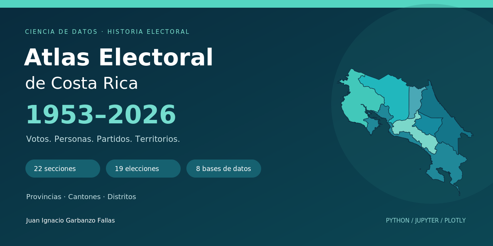</p>

# Atlas Electoral de Costa Rica · 1953–2026

**Un laboratorio de historia electoral y ciencia de datos: de los resultados agregados a los cantones, distritos y trayectorias de las personas.**

[](Atlas_Electoral_V38_Publico.ipynb)
[](Atlas_Electoral_V38_Publico.ipynb)
[](#recorrido-completo)
[](LICENSE)
[](#cobertura-y-fuentes)

**Autor:** [Juan Ignacio Garbanzo Fallas](https://github.com/juaniflls) · Ciencia Política, Economía y Ciencia de Datos.  
**Contexto:** Práctica Profesional en el Instituto de Formación y Estudios en Democracia del Tribunal Supremo de Elecciones de Costa Rica (IFED–TSE). La autoría del software y su contexto académico no sustituyen la atribución de las fuentes institucionales ni convierten esta distribución en un pronunciamiento oficial del TSE.

La aplicación integra ocho bases documentales y conecta resultados presidenciales y legislativos, participación, competencia, representación, candidaturas, partidos, papeletas y recorridos nominales. Su núcleo es un notebook de Python que integra las fuentes, calcula indicadores, valida resultados y produce una aplicación HTML con datos y visualizaciones incorporados. El público puede consultar el archivo generado sin ejecutar Python.

**22 secciones temáticas**, además de una presentación inicial, permiten pasar de una pregunta nacional a su contexto territorial o nominal. El producto combina series, matrices históricas, cartografía provincial, composiciones, flujos, perfiles, búsquedas y un laboratorio estadístico. Esta documentación describe familias de vistas y sus variantes; no suma los filtros como si fueran figuras independientes ni cuenta capas antiguas como nuevas funciones.

## Empezar en dos minutos

| Quiero… | Ruta |
|---|---|
| Usar la aplicación ya generada | En el paquete completo, abrir `Atlas_Electoral_Costa_Rica_1953_2026.html` desde la raíz. |
| Obtener la aplicación desde un clon de GitHub | Ejecutar `python scripts/restaurar_aplicacion.py`; después abrir el HTML de la raíz. El archivo comprimido se encuentra en `dist/`. |
| Actualizar datos y reconstruir | Instalar `requirements-dev.txt`, abrir [el notebook público](Atlas_Electoral_V38_Publico.ipynb) y ejecutar todas las celdas en orden. |
| Revisar las ocho fuentes | Consultar [Cobertura y fuentes](#cobertura-y-fuentes) y sus [sumas SHA-256](docs/fuentes-v38.json). |
| Entender una gráfica concreta | Ir al [recorrido de las 22 secciones](#recorrido-completo). |
| Revisar integridad del paquete | Ejecutar `python scripts/verificar_proyecto.py`. |

El HTML tiene sus datos y Plotly incorporados. La consulta principal funciona localmente; algunas descargas auxiliares enlazan archivos de `salidas/`, que deben acompañar al HTML para conservar también esas descargas. El notebook requiere sus dependencias de Python; no debe confundirse la autonomía del visor con la de su entorno de construcción.

## Contenido

- [Cobertura y fuentes](#cobertura-y-fuentes)
- [Cómo se recorre el Atlas](#cómo-se-recorre-el-atlas)
- [Recorrido completo](#recorrido-completo)
- [Definiciones y lectura responsable](#definiciones-y-lectura-responsable)
- [Instalación y reproducción](#instalación-y-reproducción)
- [Estructura del proyecto](#estructura-del-proyecto)
- [Descargas y exportaciones](#descargas-y-exportaciones)
- [Mantenimiento de esta distribución](#mantenimiento-de-esta-distribución)
- [Capturas y portada](#capturas-y-portada)
- [Licencia y cita](#licencia-y-cita)

## Cobertura y fuentes

El eje temporal comprende **1953, 1958 y las elecciones cuatrienales de 1962 a 2026**: 19 procesos nacionales. El ámbito provincial contiene San José, Alajuela, Cartago, Heredia, Guanacaste, Puntarenas y Limón. Las vistas territoriales usan los cantones y distritos que efectivamente aparecen en las fuentes de cada elección; no proyectan hacia atrás la división territorial actual.

Las segundas rondas presidenciales son una población específica de consulta. No se convierten en procesos legislativos ni se rellenan elecciones sin segunda ronda. La agregación nacional de las vistas comparables corresponde a las siete provincias documentadas; debe atenderse la nota de cobertura del voto exterior.

| Fuente incorporada | Archivo | Aporta |
|---|---|---|
| Resultados legislativos | [Base_Electoral_Diputaciones_1953-2026.xlsx](Base_Electoral_Diputaciones_1953-2026.xlsx) | Sufragios, escrutinio y resultados por elección y territorio. |
| Resultados presidenciales | [Base_Electoral_Presidencial_1953-2026.xlsx](Base_Electoral_Presidencial_1953-2026.xlsx) | Competencia presidencial, rondas y comparación con Diputaciones. |
| Candidaturas legislativas | [Base_Final_Candidaturas_Diputaciones_1953-2026.xlsx](Base_Final_Candidaturas_Diputaciones_1953-2026.xlsx) | Personas, cargos, condición de candidatura, partido, provincia, posición y resultado registrado. |
| Fórmulas presidenciales | [Base_Final_Candidaturas_Presidenciales_1953-2026.xlsx](Base_Final_Candidaturas_Presidenciales_1953-2026.xlsx) | Presidencia, vicepresidencias y fórmulas documentadas. |
| Diputaciones electas | [Base_Final_Diputaciones_Electas_1953-2026.xlsx](Base_Final_Diputaciones_Electas_1953-2026.xlsx) | Cámara electa y verificación de resultados nominales. |
| Diseño de papeletas | [Base_Final_Diseno_Papeletas_Diputaciones_1953-2026.xlsx](Base_Final_Diseno_Papeletas_Diputaciones_1953-2026.xlsx) | Características documentales de las papeletas legislativas. |
| Partidos políticos | [Base_Final_Partidos_Politicos_1953-2026.xlsx](Base_Final_Partidos_Politicos_1953-2026.xlsx) | Denominaciones y atributos partidarios documentados. |
| Registros de cancelación | [Base_partidos_cancelados.xlsx](Base_partidos_cancelados.xlsx) | Denominaciones, fechas e intervalos registrales y coincidencias para revisión. |

Los Excel originales se conservan sin reescritura. El [manifiesto de esta entrega](docs/fuentes-v38.json) registra el nombre, tamaño y SHA-256 de cada uno. La geometría provincial y las divisas de referencia se conservan en `recursos/`; no constituyen una base adicional de resultados electorales. Los nombres de archivo se resuelven mediante las rutinas de compatibilidad del notebook: no es necesario renombrar las fuentes manualmente para cada módulo histórico.

## Cómo se recorre el Atlas

### Controles compartidos

| Control | Función y alcance |
|---|---|
| Desde / Hasta | Delimitar el intervalo de las series y de los resúmenes que usan el periodo. |
| Territorio | Fijar el ámbito compartido de lectura; los visores territoriales añaden su navegación específica. |
| Elección de detalle | Elegir el proceso para mapas, tablas, fórmulas y comparaciones que requieren un año. |
| Texto | Adaptar la legibilidad de la interfaz. |
| Valores visibles | Mostrar u ocultar etiquetas cuando la figura admite esa opción. El cursor conserva el detalle. |
| Restablecer | Recuperar el estado inicial de los controles. |
| Guardar vista / Cargar vista | Conservar y volver a cargar la configuración de consulta admitida por la aplicación. |
| Vista completa | Ampliar el espacio del visor para explorar tablas y figuras. |
| Pestañas y botón + | Mantener recorridos dentro de la misma aplicación y abrir otros temas. |
| Navegación interna de sección | Acceder a los bloques de una sección extensa y localizar sus gráficas. |

### Conexiones entre resultados, personas y partidos

Los vínculos contextuales conectan perfiles partidarios, consulta nominal, cartografía, participación, representación y laboratorio. Un nombre identificado puede abrir el Explorador de personas y su historia; un partido puede trasladar su contexto hacia mapas o territorio. Las gráficas que admiten selección nominal permiten revisar las personas o registros que forman un segmento.

No todos los textos impresos son un enlace ni todas las capas visuales tienen el mismo tipo de clic. La identificación depende de que exista correspondencia nominal en el conjunto. La navegación conserva el contexto implementado por cada módulo; una búsqueda general no sustituye la inspección del detalle y de sus notas.

### Orientación visual

- Las matrices históricas sitúan las elecciones en el eje horizontal; las categorías y territorios se leen por filas.
- Las provincias conservan colores de referencia cuando el color identifica territorio; cuando identifica partido o magnitud, la leyenda y el cursor indican su significado.
- En las vistas territoriales se respeta la jerarquía provincia → cantón → distrito para no repetir etiquetas hostiles ni perder contexto.
- Un color de ganador representa el primer lugar por votos; una mayoría de cantones o distritos responde a otro denominador.
- Las exportaciones incorporan título y contexto. La lectura de una figura incluye su subtítulo, notas y tabla de respaldo.

## Recorrido completo

### 00 · Presentación

La entrada explica el propósito del Atlas, autoría, contexto, cobertura, fuentes y rutas recomendadas. Sus accesos llevan a participación, territorio, personas y datos; las tarjetas resumen el alcance del producto. Es una orientación para el público, además de las 22 secciones analíticas y documentales siguientes.

### 01 · Panorama

Reconocer los principales cambios en participación, competencia, oferta y representación antes de profundizar en una sección temática.

| Figura, vista o función | Qué permite analizar |
|---|---|
| **Panorama histórico** | Indicadores del periodo y tarjetas de síntesis; las cifras respetan el intervalo seleccionado. |
| **Abstencionismo (%)** | Serie histórica nacional; permite situar las elecciones y comparar el comportamiento temporal. |
| **Número efectivo de partidos** | Evolución de la fragmentación del voto legislativo mediante NEP. |
| **Mujeres: de la candidatura al escaño** | Comparación de la presencia de mujeres en la oferta y entre quienes resultaron electas. |
| **Oferta partidaria y acceso a la Asamblea** | Partidos con participación electoral y partidos que obtuvieron escaños. |
| **Personas candidatas nuevas y recurrentes por elección** | Composición entre primeras apariciones documentadas y personas ya observadas. |
| **Peso de candidaturas recurrentes** | Proporción de recurrencia respecto de la población de cada elección. |
| **Renovación y recurrencia por elección** | Resumen complementario de nuevas apariciones y continuidad nominal. |
| **Organizaciones con votos en ambas arenas** | Comparación de la oferta con resultados documentados en Presidencia y Asamblea. |

**Interacción y lectura:** Intervalo, territorio y elección de detalle. La navegación interna permite llegar a participación, competencia y representación desde la misma lectura inicial.

<details><summary>Capturas de esta sección</summary>

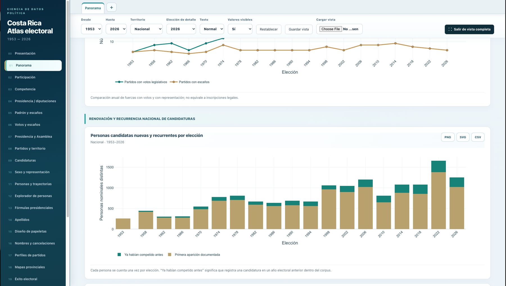

</details>

### 02 · Participación

Comparar participación, abstención y composición de los sufragios desde Costa Rica hasta sus cantones y distritos.

| Figura, vista o función | Qué permite analizar |
|---|---|
| **Series de participación y escrutinio** | Abstencionismo, participación, padrón, emitidos, válidos, blancos y nulos según la medida y arena elegidas. |
| **Comparación entre arenas** | Contraste de Presidencia y Diputaciones con denominadores explícitos; primera ronda para comparabilidad. |
| **Valores provinciales y nacional** | Matriz provincia × elección, junto al total de Costa Rica calculado desde los numeradores y denominadores. |
| **Ranking provincial histórico** | Posiciones provinciales por elección y referencia nacional; la clasificación se distingue del porcentaje observado. |
| **Composición del padrón** | Distribución del electorado entre las siete provincias a lo largo de las elecciones. |
| **Diez primeros territorios** | Vista de los cantones o distritos destacados por el indicador seleccionado. |
| **Matriz territorial completa** | Cantones agrupados por provincia; distritos organizados por provincia y cantón. Los años se leen en el eje horizontal y se conserva la jerarquía territorial. |
| **Comparación de segunda ronda** | Consulta separada de los procesos con segunda ronda presidencial; no se extiende a elecciones legislativas. |

**Interacción y lectura:** Arena, medida, nivel territorial, presentación en cantidades o porcentajes según la vista, selección territorial y rango de elecciones. Los colores provinciales ayudan a mantener el contexto; las marcas de extremos permiten identificar valores destacados.

<details><summary>Capturas de esta sección</summary>

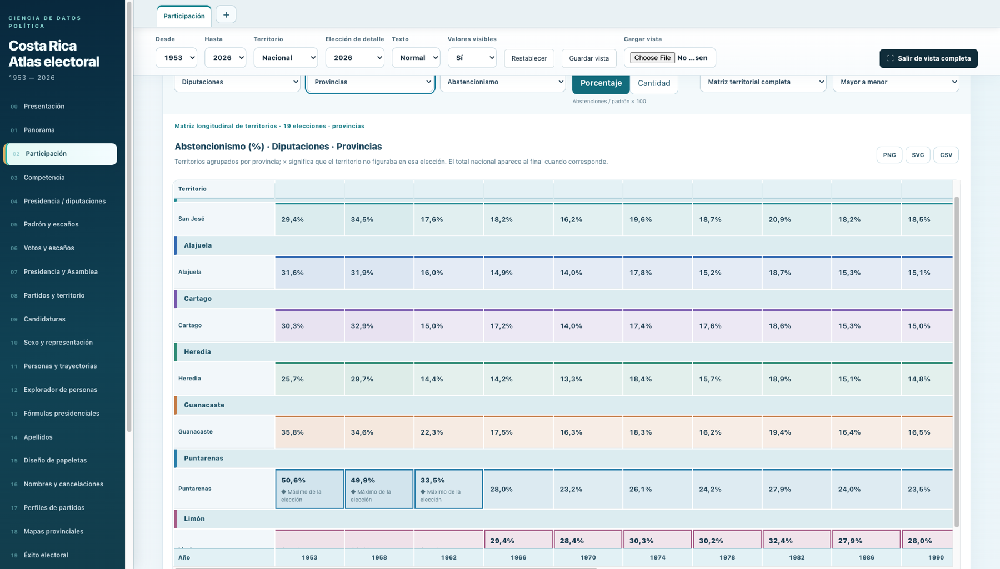

</details>

### 03 · Competencia

Distinguir cantidad de partidos, concentración del voto y competencia efectiva.

| Figura, vista o función | Qué permite analizar |
|---|---|
| **Número efectivo de partidos** | NEP electoral y parlamentario cuando la población dispone de votos y escaños. |
| **Número de partidos frente a partidos efectivos** | Diferencia entre contar organizaciones y ponderar su peso relativo. |
| **Concentración electoral** | Peso del primer lugar y de los dos partidos principales según el indicador disponible. |
| **Comparaciones entre arenas** | Lectura presidencial, legislativa o general dentro del intervalo. |
| **Matrices y comparaciones de competencia** | Variación de los indicadores por provincia y elección; los detalles descargables conservan las observaciones. |
| **Oferta y acceso a representación** | Contraste entre participación electoral y presencia efectiva en la Asamblea. |

**Interacción y lectura:** Indicador de competencia, arena y filtros globales. Los valores del cursor y las descargas permiten identificar el proceso y la escala de cada observación.

<details><summary>Capturas de esta sección</summary>

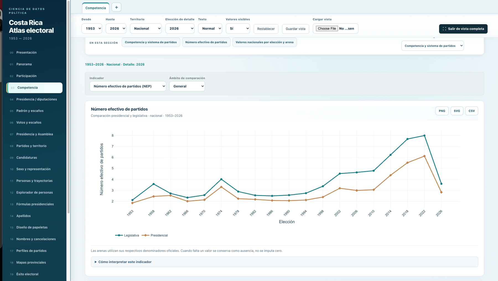

</details>

### 04 · Presidencia / diputaciones

Comparar las distribuciones agregadas de voto presidencial y legislativo sin atribuir comportamientos individuales.

| Figura, vista o función | Qué permite analizar |
|---|---|
| **Brecha presidencial − legislativa por partido** | Diferencia firmada en puntos porcentuales para una misma denominación y elección. |
| **La brecha a lo largo del tiempo** | Trayectoria temporal de la diferencia de apoyo entre arenas. |
| **Apoyo presidencial frente a legislativo** | Contraste de los porcentajes de voto del partido en las dos arenas. |
| **Divergencia entre distribuciones completas** | Distancia agregada entre las distribuciones partidarias. |
| **Quiebre del voto por provincia y elección** | Matriz histórica de distancia agregada entre Presidencia y Diputaciones. |
| **Ranking provincial del quiebre del voto** | Posición provincial por proceso y columna de promedio global. |
| **Provincias con mayor distancia en la elección de detalle** | Comparación de los siete valores en un mismo proceso. |

**Interacción y lectura:** Partido, elección y periodo. La comparación usa primera ronda presidencial; un resultado agregado diferente no identifica qué personas dividieron su voto.

<details><summary>Capturas de esta sección</summary>

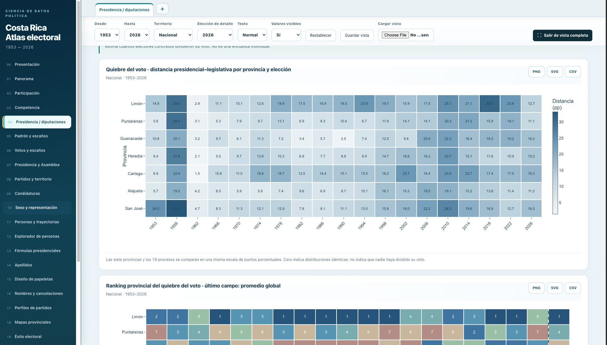

</details>

### 05 · Padrón y escaños

Examinar el peso del electorado y la distribución territorial de las diputaciones.

| Figura, vista o función | Qué permite analizar |
|---|---|
| **Distribución del padrón legislativo** | Peso de cada provincia en el electorado nacional. |
| **Escaños por provincia** | Magnitud de cada circunscripción y cambios en la asignación documentada. |
| **Peso en padrón frente a peso en escaños** | Comparación de ambas participaciones porcentuales. |
| **Sobre/subrepresentación relativa al padrón** | Brecha entre proporción de escaños y proporción de padrón en la elección seleccionada. |
| **Historia de la brecha escaños–padrón** | Series de las siete provincias con colores consistentes. |
| **Ranking provincial histórico** | Matriz 1–7 por elección y ranking global derivado del promedio de brechas firmadas. |
| **Ranking provincial de detalle** | Orden de las provincias en el proceso seleccionado. |

**Interacción y lectura:** Elección de detalle e intervalo. Los hitos de redistribución ayudan a contextualizar los cambios; una brecha territorial no equivale a una evaluación causal del sistema electoral.

<details><summary>Capturas de esta sección</summary>

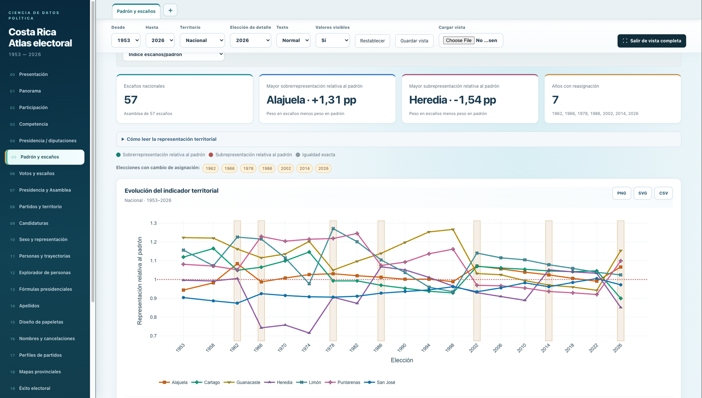

</details>

### 06 · Votos y escaños

Estudiar la conversión de los sufragios legislativos en representación partidaria.

| Figura, vista o función | Qué permite analizar |
|---|---|
| **Votos y escaños por partido** | Comparación de porcentajes de sufragios y de diputaciones. |
| **Prima o déficit de representación** | Diferencia entre porcentaje de escaños y porcentaje de votos. |
| **Desproporcionalidad a través del tiempo** | Índice de Gallagher con las distribuciones completas. |
| **Fragmentación electoral y parlamentaria** | Comparación de fragmentación del voto y de la cámara. |
| **Voto válido destinado a partidos sin diputaciones** | Puntos y tallos proporcionales; el complemento corresponde al voto a partidos con representación. |
| **Líder de votos legislativos: votos frente a escaños** | Peso electoral y bancada del partido que recibió más votos legislativos. |
| **Partido presidencial electo: voto legislativo y bancada** | El partido del ganador definitivo de la Presidencia se observa en la arena legislativa. |
| **Voto presidencial a partidos sin diputaciones** | Serie histórica de voto presidencial correspondiente a partidos sin escaños legislativos. |

**Interacción y lectura:** Vista de arenas, partido y filtros temporales. Los votos a partidos sin diputaciones no se interpretan como ausencia de representación jurídica de las personas votantes.

<details><summary>Capturas de esta sección</summary>

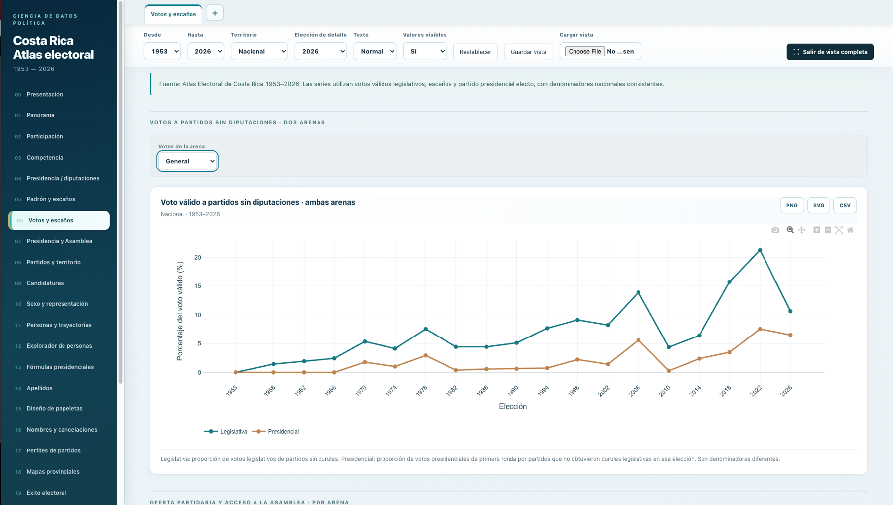

</details>

### 07 · Presidencia y Asamblea

Consultar el escrutinio territorial y su contexto con un mapa provincial siempre disponible.

| Figura, vista o función | Qué permite analizar |
|---|---|
| **Mapa provincial de resultados** | Ganador por provincia de la elección, arena y ronda vigentes; seleccionar una provincia abre su resultado total. |
| **Votos por organización política** | Barras horizontales con cantidades o porcentajes y espacio para los nombres partidarios. |
| **Resultados por territorio y organización política** | Matriz comparativa por provincias, cantones o distritos dentro del ámbito elegido. |
| **Tarjetas de escrutinio** | Válidos, emitidos, participación, abstencionismo, blancos y nulos del territorio seleccionado. |
| **Consulta del resultado total** | Resultado nacional, provincial, cantonal o distrital con su propio contexto territorial. |
| **Exploración por cantones y distritos** | Descenso voluntario desde el total; agrupación de distritos por provincia y cantón. |
| **Identificación nominal y contexto legislativo** | Vínculos disponibles a diputaciones y personas documentadas en el contexto del resultado. |
| **Fórmula presidencial electa** | Tarjetas de la fórmula ganadora con vínculos nominales a Presidencia y vicepresidencias. |
| **Composición partidaria de la Asamblea** | Representación de la cámara electa y de sus bancadas. |
| **Cámara por provincia** | Agrupación de diputaciones nominales por las siete circunscripciones y registro completo de la Asamblea. |
| **Presidencia, líder legislativo y primera bancada** | Identificación de tres resultados que pueden corresponder a partidos diferentes. |
| **Escaños provinciales del partido presidencial** | Composición territorial de la bancada del partido ganador de la Presidencia. |
| **Comparador cartográfico entre arenas** | Voto presidencial, legislativo y brecha del partido seleccionado; distribución y tendencia contextual. |

**Interacción y lectura:** Elección, Presidencia o Diputaciones, ronda solo cuando corresponde a Presidencia, provincia, cantón, distrito, total o comparación territorial y modo de presentación. El mapa se apila sobre el resultado para evitar recortes. El botón de regreso al total de Costa Rica y la navegación territorial permiten recuperar el contexto. Esta sección conserva el comportamiento aprobado de la V38.

<details><summary>Capturas de esta sección</summary>

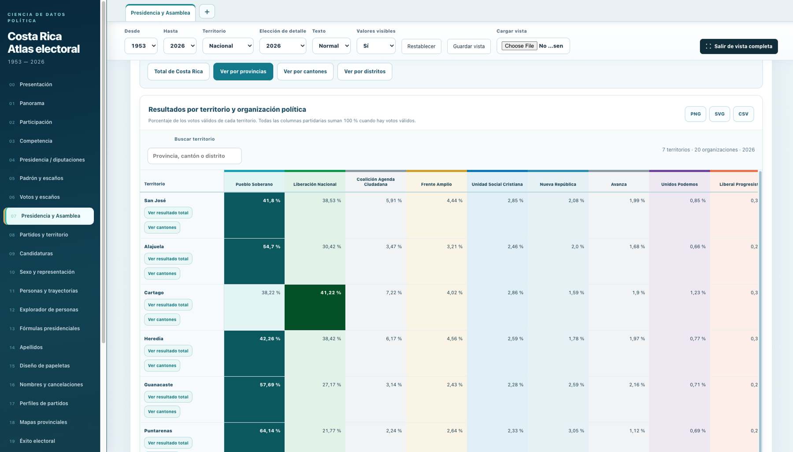

</details>

### 08 · Partidos y territorio

Distinguir quién recibe más votos de quién domina una mayor cantidad de unidades territoriales.

| Figura, vista o función | Qué permite analizar |
|---|---|
| **Partido más votado** | Matriz histórica provincia/cantón/distrito × elección con identificación partidaria y colores. |
| **Predominio de cantones por provincia** | Para cada provincia y elección: partido con más primeros lugares cantonales, unidades ganadas / unidades observadas y porcentaje. |
| **Predominio de distritos por provincia** | La misma lectura usando los distritos efectivamente observados en cada proceso. |
| **Diferencias: votos provinciales y predominio territorial** | Coincidencias, diferencias y empates entre ganador provincial y partido con más cantones o distritos; conserva los nombres y denominadores. |
| **Composición de los primeros lugares electorales** | Resumen nacional de victorias territoriales por partido dentro del intervalo. |
| **Composición por provincia** | Las siete provincias en una visualización conjunta de sus primeros lugares; composición porcentual y cantidades auditables. |
| **Bastiones y concentración del voto** | Diferencia entre apoyo local y cuota nacional del partido en la misma arena y elección. |
| **Matriz de competencia territorial** | Lectura comparada de fortaleza local y resultados observados. |
| **Persistencia histórica de la fortaleza** | Continuidad de la ventaja y primeros lugares a lo largo de las elecciones. |
| **Oferta partidaria por arena y cobertura** | Clasificación de participación presidencial, legislativa o ambas; cobertura legislativa de una, varias o siete provincias. |
| **Evolución histórica de partidos** | Series y matrices configurables de identidades, candidaturas y diputaciones por categorías observadas. |
| **Transiciones entre participaciones** | Origen y destino, composición del flujo y matriz de cambios de clasificación entre participaciones consecutivas. |
| **Participación electoral única y cohortes** | Composición y matrices de organizaciones observadas en un solo proceso y recorridos de clasificación. |
| **Composición de diputaciones por participación partidaria** | Resultados electos según participación presidencial y cobertura legislativa observada. |

**Interacción y lectura:** Arena, dimensión territorial, lectura provincial por votos/cantones/distritos, periodo y partido según bloque. Las segundas rondas se exploran separadamente. Las descargas de composición pueden ser individuales o conjuntas; el alcance de cada botón acompaña a la figura. Una victoria en una provincia puede diferir de la mayoría de sus cantones o distritos, y la cobertura observada no certifica escala jurídica.

<details><summary>Capturas de esta sección</summary>

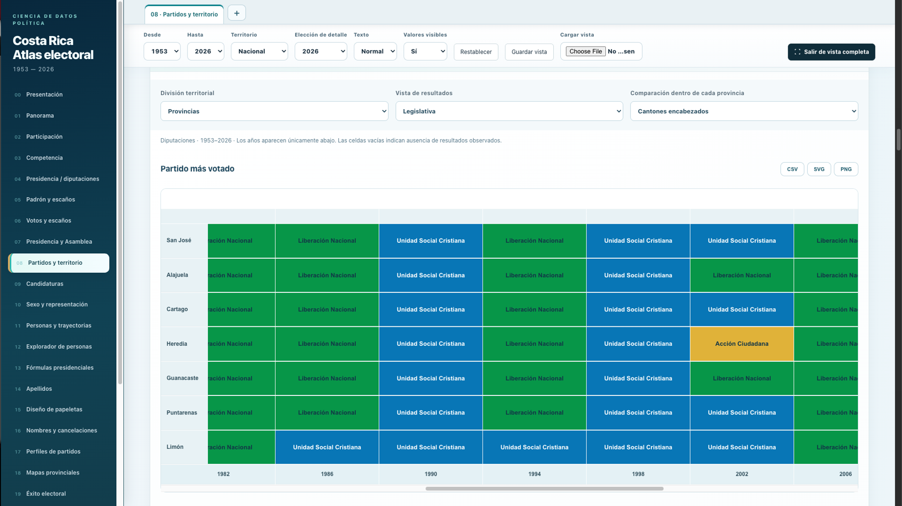

</details>

### 09 · Candidaturas

Explorar la oferta nominal y las características de las listas legislativas.

| Figura, vista o función | Qué permite analizar |
|---|---|
| **Evolución del tamaño de las listas** | Número de candidaturas registradas por elección y ámbito. |
| **Posiciones de lista** | Distribución de posiciones y condición de candidatura. |
| **Candidaturas, encabezamientos y escaños** | Contraste de oferta, primeras posiciones y resultados documentados. |
| **Mujeres por posición de lista** | Presencia de mujeres dentro del orden de las candidaturas. |
| **De la postulación propietaria al escaño** | Relación entre candidaturas propietarias y resultados electos. |
| **Experiencia electoral registrada** | Primeras apariciones y recurrencias dentro de la cobertura disponible. |
| **Catálogo nominal de candidaturas** | Tarjetas y búsqueda de nombres, partidos, cargos y resultados; CSV de la selección. |

**Interacción y lectura:** Población, condición propietaria/suplente, sexo, partido, resultado, trayectoria y texto libre según vista. Los nombres identificados permiten abrir el Explorador de personas.

<details><summary>Capturas de esta sección</summary>

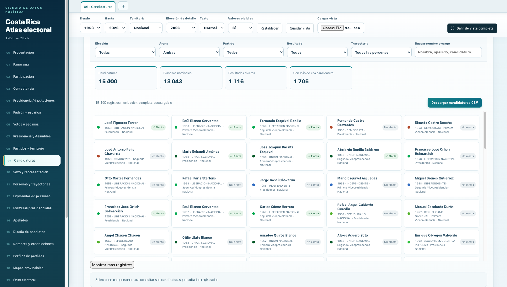

</details>

### 10 · Sexo y representación

Comparar composición de la oferta y acceso documentado a los cargos por sexo.

| Figura, vista o función | Qué permite analizar |
|---|---|
| **Composición por sexo a través del tiempo** | Participación relativa de cada categoría dentro de la población seleccionada. |
| **Composición entre candidaturas electas** | Distribución por sexo de las personas electas en cada elección. |
| **Composición entre candidaturas no electas** | Distribución equivalente entre las postulaciones sin elección registrada. |
| **Dentro de cada sexo: electas y no electas** | El denominador cambia a las candidaturas de cada sexo; no confundir con la composición del conjunto de personas electas. |
| **Tasa de elección por sexo** | Resultados electos respecto de candidaturas en cada grupo. |
| **Número de registros por sexo** | Cantidades documentadas, complementarias a las composiciones. |
| **Consulta nominal de segmentos** | Selección de una parte de la gráfica para reconocer las candidaturas que aportan al resultado. |
| **Hitos institucionales** | Referencias normativas contextualizan las series legislativas sin modificar los datos. |

**Interacción y lectura:** Población, partido y filtros globales; los clics conservan año, sexo y resultado en la consulta nominal. Los valores desconocidos se distinguen de los ceros.

<details><summary>Capturas de esta sección</summary>

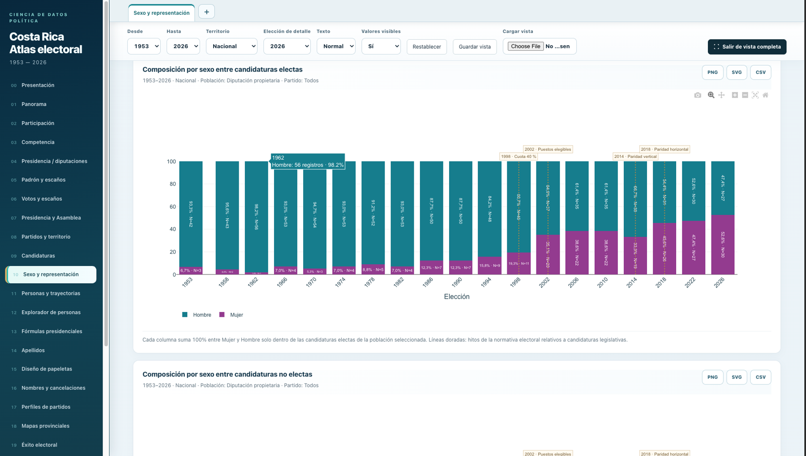

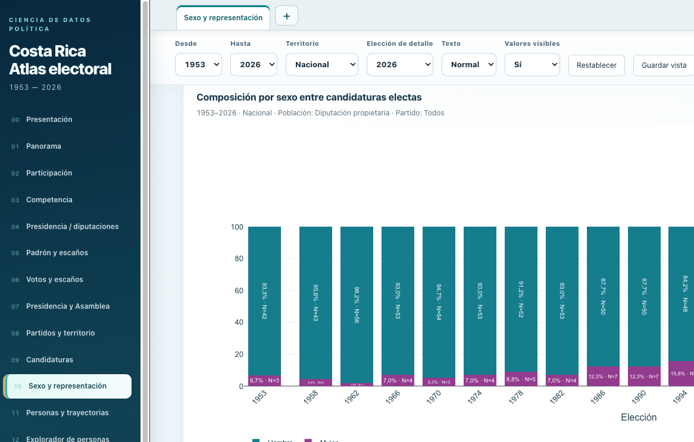

</details>

### 11 · Personas y trayectorias

Reconstruir recorridos nominales entre candidaturas, elecciones, partidos, provincias y cargos.

| Figura, vista o función | Qué permite analizar |
|---|---|
| **Doble postulación: evolución histórica** | Casos persona–elección con candidatura a diputación y a un cargo de fórmula presidencial. |
| **Composición de la doble postulación por cargo nacional** | Presidencia, primera y segunda vicepresidencia se distinguen en su relación con diputaciones. |
| **Matriz provincia × elección de doble postulación** | Cantidades, totales provinciales y total Costa Rica con una escala compartida. |
| **Concentración territorial de dobles postulaciones** | Distribución de casos por provincia de la candidatura legislativa. |
| **Éxito legislativo en la doble postulación** | Proporción que resultó electa a diputación dentro de esos casos. |
| **Resultados simultáneos de las postulaciones dobles** | Relación de los resultados documentados en ambos cargos. |
| **Movilidad provincial** | Matriz de movimientos y flujos entre provincias para candidaturas legislativas. |
| **Flujos entre participaciones consecutivas** | Cambios y continuidad de partido, provincia o cargo; un enlace cuenta transiciones documentadas. |
| **Matriz de trayectorias entre cargos** | Incluye repetir el mismo cargo en años diferentes. |
| **Consulta nominal de recorridos** | Personas que forman cada flujo y enlaces a su historial completo. |
| **Matrices de doble postulación por cargo** | Casos totales y diputaciones electas para cada cargo nacional, con visor nominal y ceros observados. |
| **Auditoría de dobles postulaciones con partidos distintos** | Casos que requieren revisar la correspondencia de denominaciones entre los cargos. |
| **Historias completas de la selección** | Relación nominal y cronología de personas presentes en los filtros. |

**Interacción y lectura:** Población, origen, destino, cargo, resultado, sexo y partido según el análisis. Una persona puede aportar varias transiciones; los casos no se equiparan automáticamente a personas distintas. El antecedente de 1990 se documenta sin atribuciones jurídicas automáticas.

<details><summary>Capturas de esta sección</summary>

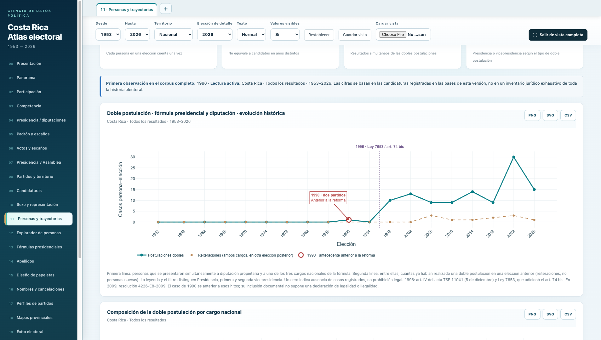

</details>

### 12 · Explorador de personas

Reunir la trayectoria electoral documentada de una persona en un solo perfil.

| Figura, vista o función | Qué permite analizar |
|---|---|
| **Búsqueda avanzada** | Nombre completo y filtros de población, sexo, partido, cargo, resultado y trayectoria disponibles. |
| **Perfil electoral nominal** | Nombre, cobertura del registro y resumen de participaciones, cargos o resultados. |
| **Historia electoral completa** | Tarjetas cronológicas con año, cargo, partido, provincia y resultado. |
| **Cronología visual de candidaturas y resultados** | Línea de tiempo de los eventos documentados. |
| **Recorrido electoral de la persona** | Cambios de cargo, partido o provincia que constan en la base. |
| **Contexto de cada participación** | Acceso al contexto partidario y territorial cuando existe correspondencia. |

**Interacción y lectura:** Selector nominal y búsqueda; otros módulos pueden abrir directamente la identidad seleccionada. Los vínculos se basan en la conciliación nominal, no en una verificación civil exhaustiva.

<details><summary>Capturas de esta sección</summary>

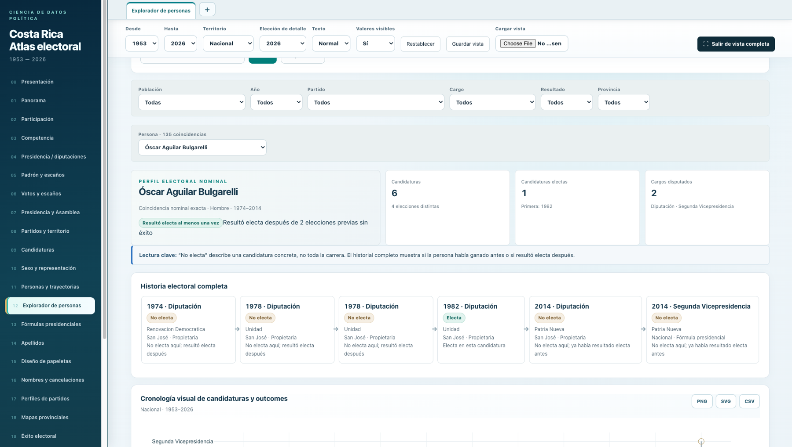

</details>

### 13 · Fórmulas presidenciales

Identificar las fórmulas que compitieron en una elección y abrir las trayectorias de sus integrantes.

| Figura, vista o función | Qué permite analizar |
|---|---|
| **Fórmulas que compitieron por elección** | Una tarjeta por fórmula, con color partidario, partido y condición de fórmula electa o candidatura registrada. |
| **Presidencia y vicepresidencias** | Tres posiciones de cada fórmula; los nombres enlazan al Explorador de personas cuando hay identificación nominal. |
| **Presidencias electas: recorrido histórico** | Lectura de las presidencias electas documentadas. |
| **Consulta nominal presidencial** | Búsqueda y filtros dentro de la población presidencial, con exportación de registros. |
| **Resumen documental de la elección** | Fórmulas, integrantes y resultados de la fuente sin duplicar la cuadrícula de fórmulas. |

**Interacción y lectura:** Elección y consulta nominal. Se conserva la visualización con colores y vínculos; no se muestran dos versiones repetidas de la misma cuadrícula.

<details><summary>Capturas de esta sección</summary>


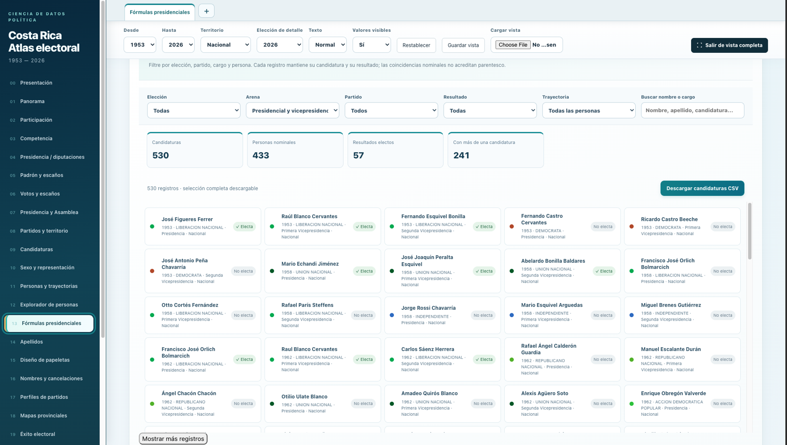

</details>

### 14 · Apellidos

Explorar coincidencias nominales entre personas distintas y facilitar la revisión de posibles conexiones documentales.

| Figura, vista o función | Qué permite analizar |
|---|---|
| **Coincidencias por personas distintas** | Ranking de apellidos que se repiten entre identidades nominales, evitando contar cada candidatura como una persona adicional. |
| **Persona de referencia** | Permite escoger una persona histórica y explorar coincidencias de sus apellidos con otras personas. |
| **Apellidos coincidentes por elección** | Serie temporal de presencia de coincidencias documentadas. |
| **Personas que comparten un apellido** | Tarjetas de las identidades relacionadas con vínculos a sus perfiles; la persona de referencia se excluye de sus propias coincidencias. |
| **Contexto partidario, cargos y resultados** | Filtros y resumen del universo para comparar apellidos dentro de poblaciones diferentes. |
| **Consulta nominal y descarga** | Lista de registros que respalda la exploración y exportación del resultado. |

**Interacción y lectura:** Población, criterio de coincidencia, persona de referencia, apellido, sexo, partido y resultado según el bloque. Compartir uno o dos apellidos no demuestra parentesco ni la existencia de una familia política.

<details><summary>Capturas de esta sección</summary>

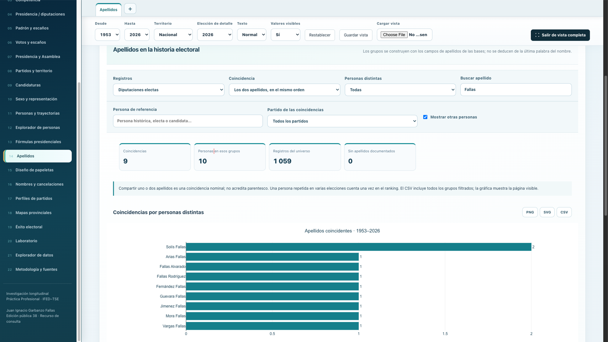

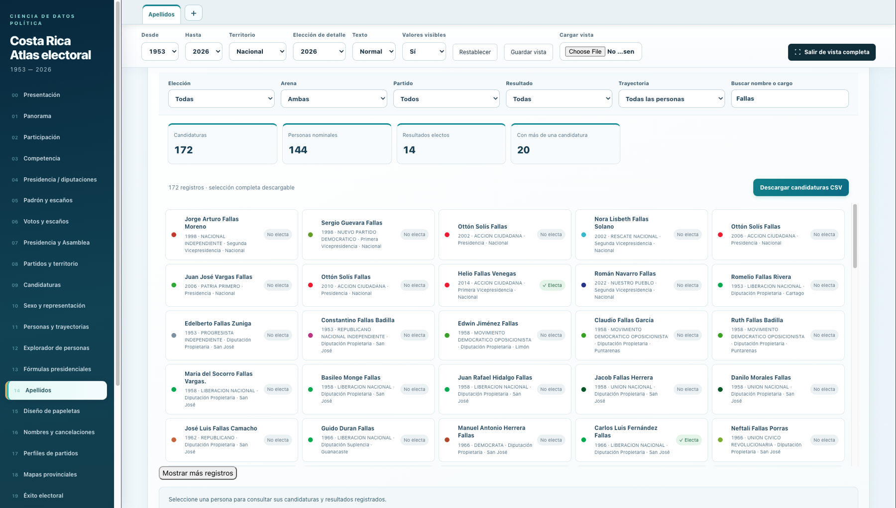

</details>

### 15 · Diseño de papeletas

Relacionar características documentadas de las papeletas legislativas con su contexto histórico.

| Figura, vista o función | Qué permite analizar |
|---|---|
| **Historia de las características registradas** | Matriz elección × característica de diseño y codificación documental. |
| **Características de la elección de detalle** | Tabla de provincias y variables presentes en la fuente. |
| **Comparación de voto no válido y diseño** | Lecturas descriptivas entre características registradas y blancos/nulos; no atribuyen causalidad. |
| **Recursos documentales** | Material de referencia disponible y distinción de reconstrucciones cuando corresponde. |

**Interacción y lectura:** Elección y característica. La matriz no sustituye el facsímil original; una ausencia documental no equivale a ausencia del elemento impreso.

<details><summary>Capturas de esta sección</summary>

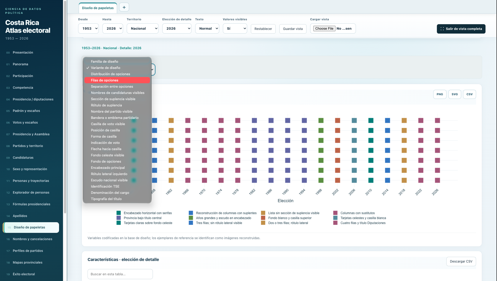

</details>

### 16 · Nombres y cancelaciones

Examinar denominaciones partidarias y registros administrativos sin asumir continuidad jurídica por similitud del nombre.

| Figura, vista o función | Qué permite analizar |
|---|---|
| **Cronología de nombres y cancelaciones** | Intervalos registrales por denominación y estado documentado. |
| **Denominaciones con múltiples registros** | Nombres presentes en más de un registro, con sus diferencias documentales. |
| **Registros cuyo intervalo comprende cada elección** | Serie de intervalos registrales observados en cada proceso. |
| **Tiempo entre cancelación e inscripción del mismo nombre** | Distancia entre eventos registrados de denominaciones iguales. |
| **Palabras en los nombres partidarios** | Frecuencias de componentes nominales dentro de las organizaciones observadas. |
| **Coincidencias entre registros electorales y administrativos** | Tabla para revisar correspondencias sin convertir una etiqueta compartida en identidad jurídica. |

**Interacción y lectura:** Estado registral, filtro de denominaciones y periodo de lectura según vista. Las fechas y vacíos se conservan como datos de la fuente.

<details><summary>Capturas de esta sección</summary>

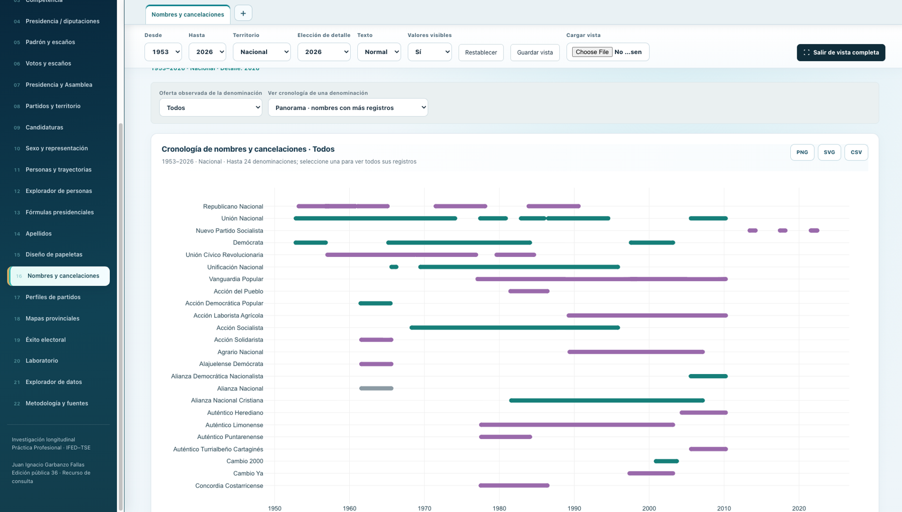

</details>

### 17 · Perfiles de partidos

Consolidar lo documentado sobre una denominación y conectarlo con el resto del Atlas.

| Figura, vista o función | Qué permite analizar |
|---|---|
| **Selector e identidad visual** | El selector del partido y la tarjeta con su bandera aparecen primero. La divisa se presenta como referencia visual, sin certificar su uso por homónimos en cada año. |
| **Apoyo electoral del nombre seleccionado** | Trayectoria presidencial y legislativa del porcentaje de votos válidos. |
| **Bancada a través del tiempo** | Diputaciones electas documentadas para el partido. |
| **Distribución provincial del apoyo** | Comparación del peso electoral entre provincias. |
| **Cobertura efectiva de candidaturas** | Presencia legislativa observada en el territorio. |
| **Dónde encabeza cantones y distritos** | Matriz provincial × elección del porcentaje de unidades donde obtuvo primer lugar, con unidades ganadas y observadas. |
| **Candidaturas y escaños** | Oferta nominal y resultados electos por elección. |
| **Representación por sexo** | Composición por sexo de las candidaturas del partido. |
| **Personas del partido** | Tarjetas y enlaces a perfiles nominales relacionados. |
| **Registros y tablas del perfil** | Elecciones observadas, candidaturas, diputaciones y coincidencias registrales según la cobertura. |
| **Explorar el partido en el Atlas** | Navegación contextual a territorio, mapas, participación, representación y personas con el partido seleccionado. |
| **Presencia entre ganadores nacionales** | Resultados nacionales y personas electas a la Presidencia bajo la denominación seleccionada. |
| **Fórmulas presidenciales del partido** | Participaciones de la organización en el ámbito nacional, con su consulta documental. |
| **Resumen territorial del apoyo legislativo** | Valores provinciales y posición del partido en primeros lugares cantonales y distritales. |

**Interacción y lectura:** Un único selector partidario, intervalo y territorio. Los subpaneles de territorio, representación y personas complementan el perfil consolidado. Las cifras registrales pueden tener cobertura temporal distinta, indicada en la tarjeta.

<details><summary>Capturas de esta sección</summary>

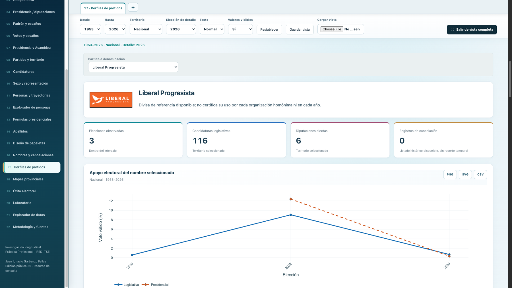

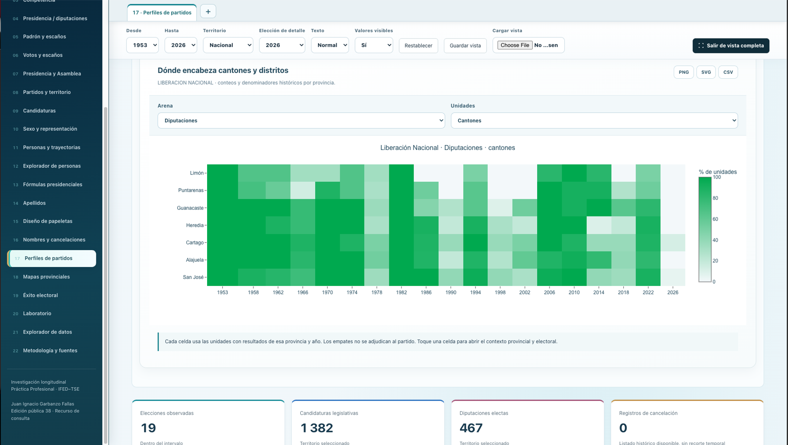

</details>

### 18 · Mapas provinciales

Comparar medidas de las siete provincias, sus cambios y su evolución dentro de una vista cartográfica conectada.

| Figura, vista o función | Qué permite analizar |
|---|---|
| **Mapa de valores provinciales** | Participación, abstencionismo, votos u otras medidas compatibles con el modo y partido seleccionados. |
| **Cambio respecto de otra elección** | Diferencia provincial entre el proceso de detalle y la referencia. |
| **Comparar dos elecciones** | Valores de ambos procesos junto al cambio correspondiente. |
| **Brecha presidencial y legislativa** | Diferencia firmada para un partido o distancia agregada cuando se compara el conjunto. |
| **Representación relativa al padrón** | Relación entre peso provincial en el electorado y escaños, con denominadores identificados. |
| **Ranking provincial asociado al mapa** | Orden de las siete provincias para la medida actual. |
| **Explorar una provincia** | Tarjetas del valor actual, referencia y variación; selección por mapa o botones provinciales. |
| **Evolución provincial** | Trayectorias temporales de la medida que acompaña al mapa. |
| **Valores provinciales del mapa** | Tabla descargable que respalda la cartografía. |
| **Conexiones contextuales** | Abrir participación, competencia, laboratorio y el resultado provincial relacionado. |

**Interacción y lectura:** Arena, modo, medida, partido, elección de referencia y provincia. Los faltantes se mantienen como tales; la brecha de un partido no se confunde con la distancia entre distribuciones completas. Esta sección es distinta del visor de escrutinio de la sección 07.

<details><summary>Capturas de esta sección</summary>

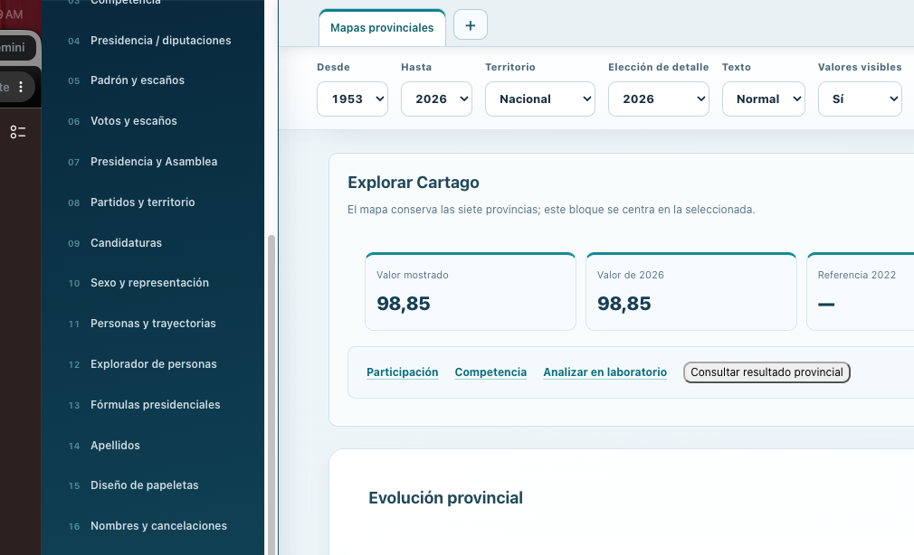

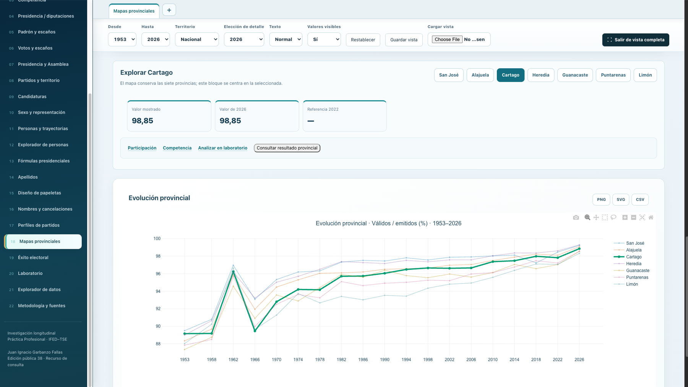

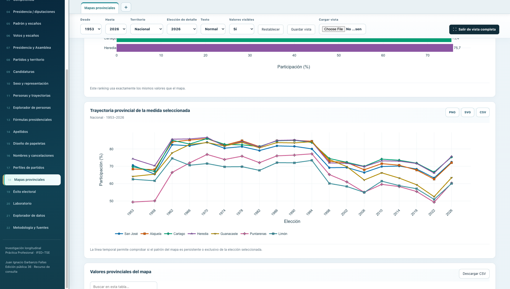

</details>

### 19 · Éxito electoral

Distinguir resultados de candidaturas, personas electas, intentos previos y antecedentes de sus carreras.

| Figura, vista o función | Qué permite analizar |
|---|---|
| **Resultados de candidaturas por elección** | Distribución entre electas y no electas para la población seleccionada. |
| **Resultado de personas** | Resumen por personas nominales distintas, separado del conteo de candidaturas. |
| **Tasa de elección por experiencia y movilidad** | Contraste descriptivo de grupos de trayectoria. |
| **Carrera de candidaturas no electas** | Qué resultados posteriores se observan dentro de la cobertura. |
| **Elecciones disputadas entre quienes repitieron** | Distribución del número de años electorales distintos. |
| **Ruta hasta la primera elección exitosa** | Incluye el universo completo y distingue las personas nunca observadas como electas. |
| **Entre quienes sí fueron electos** | Intentos documentados hasta su primera elección exitosa. |
| **Reelecciones observadas después de la primera victoria** | Resultados electos posteriores dentro del intervalo documental. |
| **Antecedentes de quienes ganaron un cargo** | Dos distribuciones: cargos ganados previamente y cargos disputados por quienes todavía no habían ganado. |
| **Personas que aportan a cada antecedente** | Selección nominal de segmentos, tarjetas y tablas auditables de los eventos previos. |

**Interacción y lectura:** Cargo, unidad de análisis, población y filtros de trayectoria. Los porcentajes de antecedentes cuentan eventos anteriores; no equivalen a porcentajes de personas. El redondeo visible puede distribuir restos para sumar 100,0 %, y el CSV conserva el valor sin redondear.

<details><summary>Capturas de esta sección</summary>

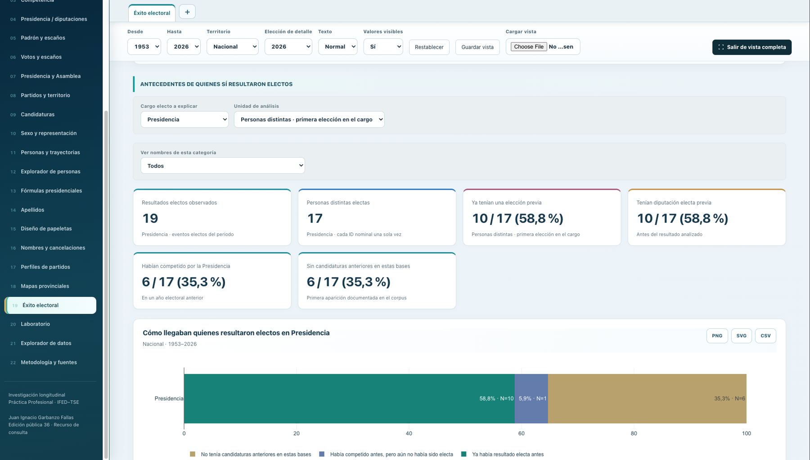

</details>

### 20 · Laboratorio

Cruzar los conjuntos integrados y explorar relaciones estadísticas con observaciones y denominadores inspeccionables.

| Figura, vista o función | Qué permite analizar |
|---|---|
| **Dispersión y ajuste lineal** | Relación entre dos variables, recta OLS y resúmenes de observaciones completas, Pearson, Spearman, pendiente y R². |
| **Distribuciones por provincia** | Diagramas de caja con observaciones, mediana y cuartiles para comparar la dispersión provincial. |
| **Tendencia de variables** | Mediana y cuartiles territoriales por elección; lectura descriptiva sin ponderación automática. |
| **Matriz de correlaciones** | Comparación multivariable con los pares completos disponibles y su número de observaciones. |
| **Componentes principales** | Proyección de casos completos, proporción de varianza y cargas de las variables seleccionadas. |
| **Agrupamiento exploratorio** | Clasificación de observaciones mediante variables estandarizadas y agrupamiento reproducible. |
| **Cruce de categorías** | Tabla/matriz de contingencia y asociación mediante V de Cramér cuando es calculable. |
| **Diccionario y lectura del cruce** | Definiciones de variables, unidades de observación y advertencias específicas del análisis. |
| **Exportación del análisis** | Registros usados y representación gráfica del cruce seleccionado. |

**Interacción y lectura:** Universo, arena, nivel territorial, tarea, variables X/Y, color de puntos y variables múltiples según método. Se requieren casos completos y variación suficiente. Los resultados son exploratorios: correlación, regresión, componentes y grupos no establecen causalidad ni parentesco.

<details><summary>Capturas de esta sección</summary>

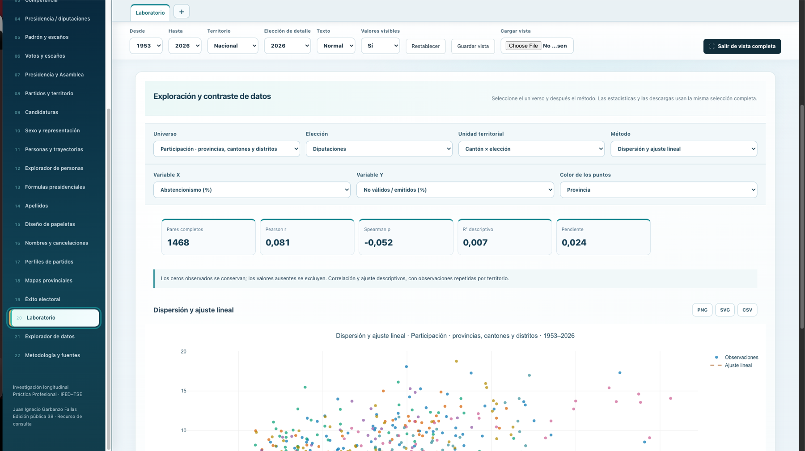

</details>

### 21 · Explorador de datos

Construir consultas y descargas verificables de las tablas que alimentan el Atlas.

| Figura, vista o función | Qué permite analizar |
|---|---|
| **Centro de datos: consulta personalizada** | Selección del conjunto, arena, población y texto de búsqueda. |
| **Filtros de resultados y candidaturas** | Provincia, partido, año, sexo, condición y resultado cuando existen en la tabla. |
| **Selector de columnas** | Mostrar, ocultar, seleccionar todas o limpiar columnas exportables. |
| **Tabla consultable** | Vista de filas y columnas seleccionadas, con información del conjunto y filtros. |
| **Descarga de selección** | CSV de la consulta activa; no confundir con la descarga de la tabla completa. |
| **Descargas temáticas y fuentes originales** | Acceso a conjuntos derivados y al paquete de bases disponible en el proyecto. |
| **Conciliación de nombres** | Decisiones nominales y registros de auditoría para revisar cómo se vinculan las personas. |

**Interacción y lectura:** Los controles se adaptan al esquema de cada conjunto. La aplicación ofrece descargas locales; algunos archivos auxiliares requieren conservar la carpeta salidas junto al HTML.

<details><summary>Capturas de esta sección</summary>

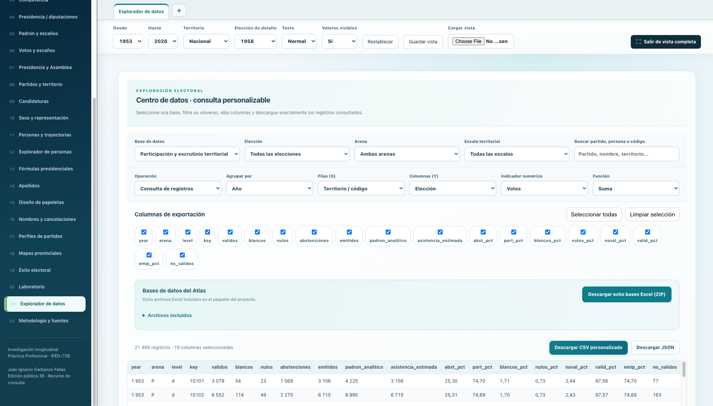

</details>

### 22 · Metodología y fuentes

Hacer explícitos el alcance, las unidades de análisis, las fórmulas y las cautelas del producto.

| Figura, vista o función | Qué permite analizar |
|---|---|
| **Cobertura documental** | Elecciones, provincias, unidades territoriales y rondas incluidas. |
| **Autoría y contexto** | Proyecto académico de Práctica Profesional IFED–TSE y autoría del desarrollo. |
| **Definiciones y fórmulas** | Participación, abstención, voto no válido, NEP, brechas, representación y otros indicadores usados. |
| **Identidades nominales** | Límites de la normalización de personas y partidos; los homónimos no se resuelven por suposición. |
| **Fuentes y extensiones documentales** | Catálogo de bases, derivados y alcance de los vínculos. |
| **Guía de controles y descargas** | Interpretación de filtros, años, territorio, detalle y exportaciones. |
| **Glosario metodológico** | Diferencias entre cobertura electoral, escala jurídica, categorías de participación y resultados. |

**Interacción y lectura:** Lectura de notas, tablas y vínculos. La aplicación complementa la consulta de las fuentes institucionales y conserva los faltantes y restricciones de cobertura.

<details><summary>Capturas de esta sección</summary>


</details>

## Definiciones y lectura responsable

### Unidades que deben distinguirse

| Unidad | Significado |
|---|---|
| Persona nominal | Identidad conciliada a partir de nombres y campos documentales; no equivale necesariamente a identidad civil comprobada. |
| Candidatura | Registro de una postulación concreta; una persona puede tener varias, incluso en una elección. |
| Persona–elección | Presencia de una identidad en un proceso; se usa cuando la pregunta requiere evitar contar varios cargos como personas diferentes. |
| Resultado electo | Evento de elección de un cargo; una persona puede aportar varios resultados históricos. |
| Transición | Paso entre participaciones consecutivas documentadas; una misma persona puede aportar más de un paso. |
| Primer lugar territorial | Partido con más votos en un territorio y elección. Acumular victorias no equivale a contar territorios históricos únicos. |
| Cobertura legislativa | Número de provincias con participación/listas observadas; no certifica la escala legal de inscripción de un partido. |

### Indicadores

| Indicador | Cálculo o criterio |
|---|---|
| Abstencionismo | Abstenciones / padrón × 100. |
| Participación | Complemento del abstencionismo cuando se usa el mismo padrón y definición de asistencia. |
| Voto blanco o nulo | Votos de esa categoría / emitidos × 100. |
| Votos válidos relativos | Válidos / emitidos × 100 cuando la vista pregunta por la composición del escrutinio. |
| Porcentaje de un partido | Votos del partido / votos válidos de la misma arena, elección y territorio × 100. |
| NEP | Inverso de la suma de los cuadrados de las proporciones partidarias; se distingue voto de escaños. |
| Gallagher | Raíz cuadrada de la mitad de la suma de diferencias cuadradas entre porcentajes de votos y escaños. |
| Brecha entre arenas | Porcentaje presidencial menos legislativo del mismo partido, en puntos porcentuales. |
| Distancia agregada entre arenas | Mitad de la suma de diferencias absolutas entre las proporciones de voto de ambas distribuciones; expresada en puntos porcentuales. |
| Brecha territorial de representación | Porcentaje provincial de escaños menos porcentaje provincial del padrón, cuando la vista usa puntos porcentuales. El índice relativo del mapa identifica su propio cociente. |
| Dominio territorial | Unidades con primer lugar del partido / unidades observadas en la provincia y elección × 100. |
| Fortaleza local | Cuota local del partido menos su cuota nacional en la misma arena y elección. |
| Tasa de elección | Resultados electos / candidaturas del grupo correspondiente × 100. |
| Correlación y ajuste | Pearson, Spearman y OLS descriptivos sobre observaciones completas; no pruebas causales. |

La tasa nacional se obtiene de totales compatibles; no es el promedio simple de las tasas provinciales. La cobertura cantonal y distrital cambia con el tiempo: las matrices utilizan denominadores de cada proceso. Los empates no se adjudican por conveniencia a un partido. **Cero**, **sin dato** y **no aplicable** son estados distintos.

La conciliación nominal conserva las grafías de origen y sus decisiones auditables. Una forma de un nombre puede vincularse a una forma más extensa solo bajo condiciones documentales y unicidad; los casos ambiguos no se resuelven arbitrariamente. Compartir apellidos constituye una pista de exploración, no prueba de parentesco. Compartir denominación partidaria no prueba continuidad jurídica. Los resultados electorales agregados no permiten identificar el voto individual ni inferir transferencias personales entre arenas.

La normalización conserva controles específicos de las fuentes. Por ejemplo, en el registro legislativo de 1974 se distingue el total reportado en la fuente del emitido analítico construido como válidos + blancos + nulos. Las notas de cobertura y los registros de conciliación deben acompañar cualquier reutilización publicable. Las series de recurrencia y éxito describen la historia **observada**: una primera aparición en estas bases no demuestra que sea la primera experiencia política de la persona.

## Instalación y reproducción

### Entorno de trabajo

Se recomienda Python 3.11 o 3.12 en un entorno virtual. El entorno debe instalarse antes de ejecutar el notebook; no se distribuye una carpeta virtual específica de la computadora del autor.

```bash
python -m venv .venv
```

En macOS/Linux:

```bash
source .venv/bin/activate
```

En PowerShell:

```powershell
.venv\Scripts\Activate.ps1
```

Después de activar el entorno:

```bash
python -m pip install -r requirements-dev.txt
python -m jupyterlab Atlas_Electoral_V38_Publico.ipynb
```

Ejecutar **todas las celdas en orden**, desde la raíz del proyecto. Conservar los ocho Excel y `recursos/`. El notebook resuelve nombres compatibles, integra fuentes, verifica cálculos y aplica las capas de presentación hasta producir el HTML de la raíz. No abrir una salida intermedia como si fuera la aplicación final. Una ejecución completa puede tardar y usar memoria considerable, especialmente al integrar detalle cantonal y distrital y construir el HTML autocontenido.

Las dependencias mínimas están en [requirements.txt](requirements.txt); JupyterLab se añade en [requirements-dev.txt](requirements-dev.txt). No se requiere un servidor ni una cuenta en un servicio de visualización para abrir el resultado local. La construcción genera derivados; las bases originales permanecen intactas.

### Usar la copia comprimida

El HTML autocontenido supera el límite por archivo normal de GitHub. Para conservar exactamente la aplicación sin recortarla ni cambiar sus cálculos, el repositorio incluye una copia comprimida y un restaurador:

```bash
python scripts/restaurar_aplicacion.py
```

El restaurador verifica el SHA-256 antes de escribir el HTML y evita sobrescribir un archivo diferente por accidente. Para sustituir deliberadamente una salida local regenerada, usar `--replace`. El ZIP completo de entrega ya incluye el HTML descomprimido; el archivo de `dist/` permite conservar también una copia adecuada para el repositorio.

### Verificar el proyecto

```bash
python scripts/verificar_proyecto.py
```

Comprueba las ocho fuentes mediante SHA-256, el formato JSON y la sintaxis Python de las celdas, la estructura documental, las rutas locales del README, dimensiones y tamaño de la portada y la aplicación comprimida. Este control estático no sustituye la validación con declaratorias ni una prueba visual real del navegador. El [informe de revisión de esta entrega](docs/VERIFICACION_V38.md) separa las verificaciones ejecutadas de sus límites.

## Estructura del proyecto

| Ruta | Papel |
|---|---|
| `Atlas_Electoral_V38_Publico.ipynb` | Punto de entrada reproducible para construir la edición pública. |
| `Atlas_Electoral_Costa_Rica_1953_2026.html` | Aplicación completa local; generada e ignorada por Git para evitar subir un archivo mayor de 100 MiB. |
| Ocho archivos `.xlsx` de la raíz | Fuentes documentales incorporadas. |
| `recursos/` | Pipeline, geometría, divisas, plantillas, JavaScript, CSS y módulos de compatibilidad usados por el notebook. |
| `integrar_territorios.py`, `construir_interfaz.py`, `conciliar_resultados.py`, `completar_interfaz.py`, `publicar_interfaz.py`, `publicar_aplicacion.py` | Etapas de integración territorial, construcción de interfaz, conciliación y publicación, con nombres funcionales y referencias sincronizadas en el notebook. |
| `salidas/` | Datos derivados, auditorías y descargas auxiliares. Se conservan en la entrega completa y pueden reconstruirse. |
| `dist/` | Aplicación comprimida y manifiesto de integridad. |
| `scripts/` | Restauración y comprobaciones de la distribución. |
| `assets/branding/` | Portada SVG editable y PNG listo para README/social preview. |
| `assets/screenshots/` | Capturas seleccionadas aportadas para documentar la interfaz. |
| `docs/` | Catálogos funcional y técnico, fuentes, guía de actualización e informe de verificación. |
| `.gitattributes` | Clasificación del código fuente y exclusión estadística de productos generados. |
| `.gitignore` | Exclusión de entornos, cachés y salidas reproducibles en commits nuevos. |
| `LICENSE`, `NOTICE.md`, `CITATION.cff` | Licencia del código, límites de derechos y metadatos de cita. |

Los archivos de implementación tienen nombres funcionales estables. El notebook, sus recursos incorporados y los pasos de construcción utilizan las mismas rutas. La edición pública vigente es **38**; los números de publicación se reservan para el producto entregado, no para los nombres de cada módulo.

## Descargas y exportaciones

### Desde una figura

**PNG** sirve para imágenes rasterizadas; **SVG** conserva elementos vectoriales cuando el constructor de la figura lo permite; **CSV** contiene los registros o el resumen que respalda esa vista. El título y el contexto de la selección forman parte de las exportaciones implementadas. Las figuras con controles de exportación propios deben descargarse desde ese bloque, no desde el de una gráfica vecina.

En las composiciones de primeros lugares de la sección 08 existen vistas nacional y provincial y una salida conjunta. Conviene elegir explícitamente el alcance de la descarga. Una figura descargada no equivale a exportar todo el conjunto integrado ni las ocho bases originales.

### Desde una tabla o consulta

Las descargas distinguen selección filtrada, tabla temática y fuente original. En el Explorador de datos se pueden elegir columnas, filtros y población antes de exportar. Las tablas de personas y antecedentes permiten revisar los casos que contribuyen a un porcentaje, una matriz o un flujo. Para reproducir el análisis, conservar también el periodo, territorio, arena, unidad y denominador usados.

### Para artículos y presentaciones

Preferir SVG para diagramación vectorial y PNG para compatibilidad. Revisar etiquetas largas, leyendas y contexto tras exportar. Citar la fuente institucional pertinente además del software. El tamaño de una figura dentro del visor y el tamaño de su descarga pueden ser distintos: la exportación debe inspeccionarse antes de incorporarla a un documento.

## Mantenimiento de esta distribución

### Actualizar los archivos de una copia local

1. Extraer el paquete en una carpeta temporal y revisar su contenido.
2. Copiar los archivos visibles a la carpeta de trabajo del repositorio, conservando la carpeta `.git` que ya tiene la copia local. La entrega conserva también los archivos ocultos aportados; no es necesario reemplazar una `.git` local más reciente por la copia del paquete.
3. Copiar `.gitattributes` y `.gitignore` de esta entrega: forman parte de la configuración de clasificación y exclusión de archivos.
4. Revisar los cambios en GitHub Desktop o Git y comprobar que las fuentes, notebook, recursos, documentación y portada aparecen como se espera.
5. Publicar mediante el flujo normal del repositorio. Este paquete no crea commits ni publica cambios automáticamente.

**Un archivo ya versionado no deja de estarlo por añadirlo a `.gitignore`.** Si la copia local todavía tiene checkpoints o derivados rastreados, retirarlos solo del índice conserva los archivos físicos. Antes de hacerlo, revisar la lista con `git ls-files`. El procedimiento y los ejemplos están en [ACTUALIZAR_REPOSITORIO.md](docs/ACTUALIZAR_REPOSITORIO.md). No borrar `.git`: contiene la asociación con el remoto y el historial.

### Lenguajes en GitHub

El notebook se identifica como Python mediante `.gitattributes`; los HTML y datos generados, la distribución comprimida y las capturas se excluyen de las estadísticas de código. El JavaScript y CSS de implementación siguen siendo código fuente real, sin disfrazarse como Python. GitHub recalcula su clasificación al procesar la rama publicada; el porcentaje exacto depende de los archivos rastreados y sus tamaños.

Referencias: [Linguist: clasificación](https://github.com/github-linguist/linguist/blob/main/docs/how-linguist-works.md), [atributos de clasificación](https://github.com/github-linguist/linguist/blob/main/docs/overrides.md) y [límites de archivos de GitHub](https://docs.github.com/en/repositories/working-with-files/managing-large-files/about-large-files-on-github).

### Catálogos y trazabilidad

- [Catálogo funcional de las 22 secciones](docs/catalogo-secciones-v38.json): vistas, objetivos y controles descritos en este README.
- [Inventario técnico de llamadas visuales](docs/INVENTARIO_VISUAL.md): rótulos literales detectados en los constructores del HTML, con módulo y línea. Incluye capas de compatibilidad y no debe usarse como conteo de figuras activas.
- [Inventario en JSON](docs/inventario-llamadas-visuales.json): formato reutilizable del catálogo técnico.
- [Fuentes con SHA-256](docs/fuentes-v38.json): integridad de los ocho archivos de entrada.
- [Verificación V38](docs/VERIFICACION_V38.md): comprobaciones efectivamente realizadas y límites de la revisión.

## Capturas y portada

La galería usa capturas aportadas del Atlas; los paneles desplegables de cada sección permiten recorrerlas sin convertir el README en una pared de imágenes. No se fabricaron capturas de funcionalidades faltantes. Una sección puede tener varias vistas y una captura solo representa la selección que muestra.

La portada nueva está en [PNG](assets/branding/atlas-electoral-v38.png) y en [SVG editable](assets/branding/atlas-electoral-v38.svg). Se creó como una composición vectorial con la geometría provincial distribuida en el proyecto, sin cifras electorales ficticias ni logos institucionales añadidos. El PNG mide **1280 × 640 píxeles** y pesa menos de **1 MB**, apto para cargarlo manualmente como social preview del repositorio. Cambiar el README no cambia por sí solo la social preview: esa imagen se selecciona en los ajustes de GitHub.

Referencia: [personalizar la vista previa social de un repositorio](https://docs.github.com/en/repositories/managing-your-repositorys-settings-and-features/customizing-your-repository/customizing-your-repositorys-social-media-preview).

## Licencia y cita

La distribución actual de la **versión 38** se presenta bajo una [licencia propietaria de evaluación y reserva de derechos](LICENSE), respecto de los derechos que correspondan a Juan Ignacio Garbanzo Fallas. La evaluación autorizada no implica permiso general de integración productiva, modificación, redistribución o explotación comercial del material reservado. Esos usos requieren autorización escrita o un acuerdo específico de las partes legitimadas.

La reserva no revoca autorizaciones válidamente otorgadas con anterioridad ni modifica las licencias aplicables a componentes de terceros. Las fuentes institucionales y los datos electorales mantienen su procedencia y condiciones propias. Consulte [NOTICE.md](NOTICE.md).

**Referencia sugerida del software:**

Garbanzo Fallas, J. I. (2026). *Atlas Electoral de Costa Rica: 1953–2026* (Versión 38) [Software]. GitHub. https://github.com/juaniflls/atlas-electoral-costa-rica

GitHub puede ofrecer la cita mediante [CITATION.cff](CITATION.cff). Para una cifra, una candidatura o una interpretación histórica, añadir la referencia de la fuente primaria pertinente; citar el software no reemplaza la atribución documental. Las incidencias deben describir sección, selección de filtros, resultado esperado y comportamiento observado para facilitar su reproducción.

